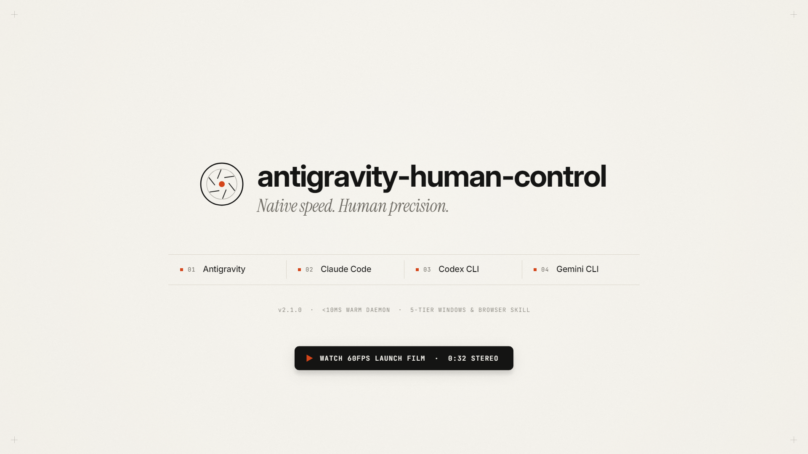

# antigravity-human-control

[](https://github.com/Daosi-dev/agent-eye/actions/workflows/ci.yml)
[](LICENSE)
[](pyproject.toml)

[Tiếng Việt (README.vi.md)](README.vi.md)

**High-speed, hybrid Windows desktop & browser automation skill** for **Antigravity**, **Codex CLI**, **Gemini CLI**, and **Claude Code**.

Combines the best of **Computer Use** (DPI-accurate Vision + human/turbo cursor) and **`agent-desktop`** (Accessibility Tree + app/window lifecycle), while fixing their biggest bottlenecks through a **Persistent Warm Daemon (`<10ms` IPC)**, **5-Stage Smart Capability Routing**, **WinRT OCR (`~50ms`)** for custom-rendered apps (CapCut, Godot, Blender), **Outer-Ruler `1000x1000` Vision**, **Single-Stroke Bezier Drag + NCC Micro-Correction**, and **Atomic Vietnamese/Unicode Clipboard Injection**.

---

## Launch Film (60fps Motion Graphics)

[](https://github.com/Daosi-dev/agent-eye/raw/main/media/agent-eye-launch-v3-60fps.mp4)

> Click the preview above to stream/download the **32s 60fps Stereo Launch Film** ([`media/agent-eye-launch-v3-60fps.mp4`](media/agent-eye-launch-v3-60fps.mp4)), rendered natively with Google Skia C++ & 48kHz SciPy DSP in [`motion_studio/`](motion_studio/).

---

## Comparison: Pure Computer Use vs. `agent-desktop` vs. `antigravity-human-control`

| Capability | Pure Computer Use (Vision-only) | `agent-desktop` (UIA-only) | `antigravity-human-control` (Hybrid 5-Tier) |
| :--- | :--- | :--- | :--- |
| **Background Browser / Dialogs** | No (steals physical cursor) | Partial (UIA only; slow Chromium settle) | **Yes** (Tier 1 Raw CDP `<20ms` + Tier 2 `#32770` Fast-Path) |
| **Accessibility Tree + Lifecycle** | No | Yes (`snapshot`, `launch`, `focus`, `close`) | **Yes** (`windows`, `launch`, `focus`, `close`, `wait`, `clipboard`, `snapshot --mode auto\|tree\|vision`) |
| **Canvas Apps (CapCut, Godot, Games)** | Slow (4–7s LLM vision loop per click) | Fails (`UIA` empty or `AMBIGUOUS_TARGET`) | **Fast** (`~50ms` Tier 2.5 WinRT OCR + Outer-Ruler `1000x1000` Vision fallback) |
| **Precision Drag & Sliders** | Single blind drag | Refuses `mouse-down`/`drag` headless | **3-Phase Drag** (Bezier/Fitts + NCC verify + micro-drag `>4px`) |
| **Vietnamese / Unicode Typing** | Breaks with UniKey/IME | `set-value` limited; `type` needs `--headed` | **Atomic UTF-16LE Clipboard Paste** (preserves prior clipboard) |
| **CLI Cold-Start Overhead** | High | Medium | **Warm Daemon (`<10ms` IPC)** + single-call `batch` pipelines |

---

## Architecture: 5-Stage Smart Telemetry Router

```text
cli.py (stdlib <25ms) ──▶ bridge_daemon.py (127.0.0.1 TCP_NODELAY + session_<integrity>.key)
                                │
                    [ <1ms UIPI & Gate Guard ]
                                │
                                ▼
                     fallback_router.py (Route Cache + 80ms Circuit Breaker)
          ┌─────────────────────┼─────────────────────┬─────────────────────┐
          ▼                     ▼                     ▼                     ▼
  Tier 1: Raw CDP       Tier 2: Win32/UIA    Tier 2.5: WinRT OCR    Tier 3: Vision 1000x1000
 (Chrome/Edge/Brave)   (Tree + #32770 Dialog) (Canvas / Custom UI)   (Outer-Ruler + Bezier Drag)
                                                                            │
                                                                            ▼
                                                                  Tier 4: Low-Level Input
                                                              (ScanCode + Atomic Clipboard)
```

---

## One-Click Installation (No Admin Required)

```powershell
git clone https://github.com/Daosi-dev/agent-eye.git
cd agent-eye
powershell -ExecutionPolicy Bypass -File .\install.ps1
```

`install.ps1` automatically:
1. Creates `.venv` (using `uv` if installed, or standard `python -m venv`).
2. Generates an integrity-scoped `session_medium.key` (or `session_high.key` when installed from an Administrator shell) in `%LOCALAPPDATA%\AntigravityControl\`.
3. Links the skill via Windows Directory Junctions to `~/.gemini/config/skills/` and `~/.agents/skills/` (pass `-AllAgents` to also link `~/.claude/skills/`).
4. Starts the Warm Daemon and runs `cli.py doctor`.

To cleanly remove junctions, daemon state, and temporary files:

```powershell
powershell -ExecutionPolicy Bypass -File .\uninstall.ps1
```

---

## Administrator Windows & Standard UAC Elevation

Windows User Interface Privilege Isolation (UIPI) prevents Medium-integrity processes from automating elevated (Administrator) applications. This tool **never** bypasses UAC or UIPI silently:

- **Integrity-Isolated Daemons**: Standard terminals use `daemon_medium.json` + `session_medium.key` (current-user ACL). Elevated Administrator terminals use `daemon_high.json` + `session_high.key` (Administrators + SYSTEM ACL only — inaccessible to Medium processes).
- **Sanctioned UAC Elevation**: If a command returns `ELEVATION_REQUIRED`, explicitly open an elevated session using Windows' standard UAC prompt:
  ```powershell
  powershell -ExecutionPolicy Bypass -File .\scripts\open_elevated_shell.ps1
  ```

---

## Security & Privacy

- **100% Local Execution**: Daemon binds strictly to `127.0.0.1` with `hmac.compare_digest` key validation.
- **No Anti-Bot / CAPTCHA Bypass**: Detects verification gates and immediately returns `HUMAN_HANDOFF_REQUIRED` so a human can complete them directly.
- **Physical Takeover & Panic Stop**: Yields immediately if you move the mouse (`USER_INTERRUPT`) or press `Ctrl+Alt+Esc`. Protected OS processes (`explorer.exe`, `csrss.exe`, `lsass.exe`, etc.) are refused on `close` (`PROTECTED_PROCESS`), and dangerous shell hotkeys require `--force`.

---

## Development & Testing

```powershell
powershell -ExecutionPolicy Bypass -File .\install.ps1 -Dev
.\.venv\Scripts\pytest.exe -v

# Re-render the 60fps showcase film (requires skia-python, scipy, ffmpeg)
.\.venv\Scripts\python.exe -m motion_studio.render_launch_film --out media\agent-eye-launch-v3-60fps.mp4
```

Licensed under the [MIT License](LICENSE).
